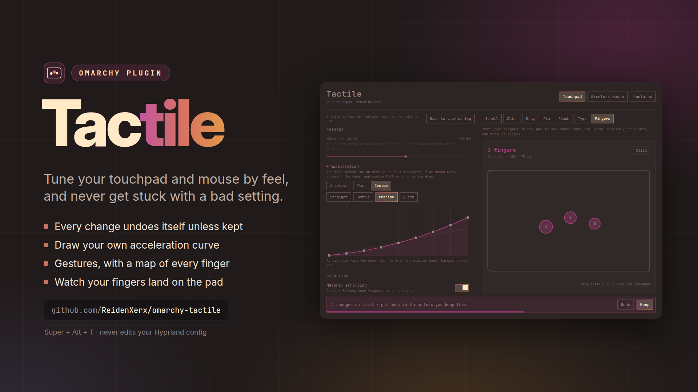

# Tactile

**Tune your touchpad and mouse by feel, and never get stuck with a bad setting.**



Press <kbd>Super</kbd> + <kbd>Alt</kbd> + <kbd>T</kbd> (or open the Omarchy menu → Setup → *Touchpad & mouse*). Every
touchpad and mouse Hyprland reports gets its own tab, with a feel lab beside the settings so you can try each change the
moment you make it.

## What only Tactile does

- **Every change undoes itself unless you keep it.** A change applies at once, and a countdown puts it back after 15
  seconds. Press Keep when it feels right. A setting that leaves you without a working pointer simply puts itself back.
- **A feel lab next to the settings.** Scroll a ruler that measures each swipe, see which button a tap or press
  reaches, drag onto a target, aim at targets that time you, pinch a card, and type while brushing the pad. The lab
  turns to the test for the setting you just touched, and its hints follow your settings ("Tap with one finger for
  left, two for right…").
- **Draw your own acceleration.** Pick *Custom* and drag the points of the curve, or start from Straight, Gentle,
  Precise or Quick. A scroll curve goes with it.
- **Gestures with a map of what your fingers do.** Add swipes and pinches that switch workspaces, show the scratchpad,
  close, fullscreen, maximize, float, move, resize or zoom. A grid shows every finger count and direction at once, and
  Tactile tells you when finger drag or another gesture takes a swipe first.
- **Changes that happen by themselves.** Turn the touchpad off while a mouse is connected, and give a device other
  settings while one app has focus, such as flat acceleration in a game.
- **See your fingers on the pad.** An opt-in live view draws each finger where it lands, at the pad's real size.
- **Your Hyprland config stays yours.** Tactile applies its settings to each device while Hyprland runs and applies them
  again after a config reload. It never edits your config files, and a setting you keep equal to your config's is handed
  back to your config.

## Settings

Pointer speed; acceleration (adaptive, flat or a custom curve); natural scrolling; scroll speed; scrolling with two
fingers or along the right edge; a scroll curve; tap to click; which buttons two- and three-finger taps press; clicking
with fingers or with the bottom corners of the pad; middle click from both buttons; left-handed buttons; tap and drag;
drag lock; three- or four-finger drag; ignoring the pad while typing; flipping either axis. Mice get the settings that
apply to them.

Each setting shows the value the device has now: your Hyprland input settings, until Tactile keeps a value of its own
for that device, which is marked with a dot. *Back to your config* hands a device back to your input settings.

## Gestures and scroll speed per app

The **Gestures** tab adds touchpad gestures on top of your Hyprland config: choose the fingers, the movement and what it
does. Narrow gestures (a swipe left) are added before broad ones (a swipe left or right), so both work together.

**Scroll speed per app** sets the touchpad scroll speed for one app, for apps that scroll too fast or too slow. Pick one
of the apps that have a window open.

## Automatically

At the bottom of a device's settings:

- **Turn off while a mouse is connected** (touchpads). The touchpad is off while Hyprland lists a mouse and comes back on
  when it does not, when Tactile cannot read the device list, and when Tactile stops.
- **In one app.** Acceleration and pointer speed used only while that app has focus.

## Finger view

Linux keeps a touchpad's raw input private, so the finger view is opt-in. Feel lab → **Fingers** → *Let Tactile see the
touchpad* asks for your password through your desktop's polkit agent (`pkexec`) and adds one rule,
`/etc/udev/rules.d/70-tactile-touchpad.rules`:

```
ACTION=="add|change", SUBSYSTEM=="input", KERNEL=="event*", ENV{ID_INPUT_TOUCHPAD}=="1", TAG+="uaccess"
```

It lets the person logged in read touchpads, never keyboards. *Stop letting apps read the touchpad* deletes the rule
again and removes the access it already gave: losing the `uaccess` tag does not take back the ACL logind put on the
touchpad's device node, so Tactile removes your entry from every touchpad node itself. The reader,
`bin/tactile-fingers`, runs only while the Fingers test is on screen.

## From scripts

```sh
omarchy-shell shell toggle reidenxerx.tactile '{"tab":"gestures"}'        # open on a device (its Hyprland name) or on gestures
omarchy-shell shell toggle reidenxerx.tactile '{"lab":"aim"}'             # open on a feel lab test
omarchy-shell shell call reidenxerx.tactile state '{"device":"<name>"}'   # what Tactile knows, as JSON
omarchy-shell shell call reidenxerx.tactile set '{"device":"<name>","field":"scroll_factor","value":0.5}'
omarchy-shell shell call reidenxerx.tactile keep '{}'                      # or undo
omarchy-shell shell call reidenxerx.tactile gestures '{"list":[{"fingers":3,"direction":"horizontal","action":"workspace"}]}'
```

`set`, `gestures`, `apps`, `padOff` and `profiles` put their change on trial, just like the window does.

## Install

```sh
omarchy plugin add https://github.com/ReidenXerx/omarchy-tactile --enable
~/.config/omarchy/plugins/reidenxerx.tactile/bin/tactile-menu-install     # Setup → Touchpad & mouse
```

`tactile-menu-install remove` takes the menu entry out again. If you allowed the finger view, take that back in the
Fingers test before removing the plugin. Deleting `/etc/udev/rules.d/70-tactile-touchpad.rules` by hand also stops it
for good, but the access already given stays until the next boot.

## How it stays safe

- Settings reach Hyprland as Lua that Tactile builds from a fixed list of settings, with each value's type and range
  checked; device names, app names and curves are validated before they get near Lua. Tactile's own settings live in
  its entry in `shell.json`.
- Commands run by absolute path, one at a time, each with a deadline, and what they print is size-checked before it is
  read.
- The shortcut is bound only when those keys are free, and taken back when Tactile stops.
- The only thing that runs as root is the finger view's fixed rule script, and only when you ask for it.

## Limits

- Hyprland cannot list gestures, so gestures in your own Hyprland config do not show on the map. When one of them
  already covers a gesture you add, Tactile says so.
- Hyprland reports only the global input settings, not the per-device ones in your config, so a device shows those
  until Tactile keeps values of its own.
- A mouse on a wireless receiver counts as connected while it sleeps.

## Tests

```sh
node tests/model-test.js              # settings, trials, curves, gestures, per-app rules, automatic changes
python3 tests/fingers_test.py         # the finger reader, on synthetic touchpad events
python3 tests/menu_install_test.py    # the menu installer, in a sandbox
```

## Support

If Tactile is useful to you, you can support its development on [Donatello](https://donatello.to/DuduPhudu).

MIT license.
